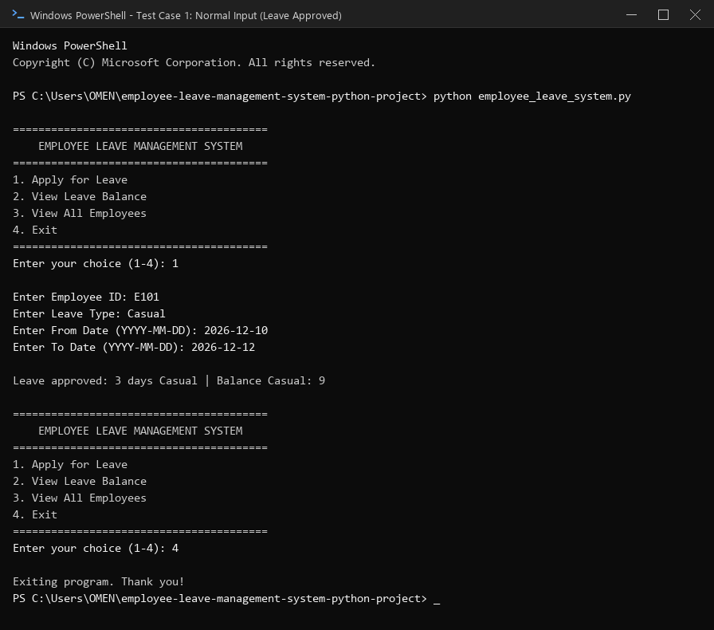
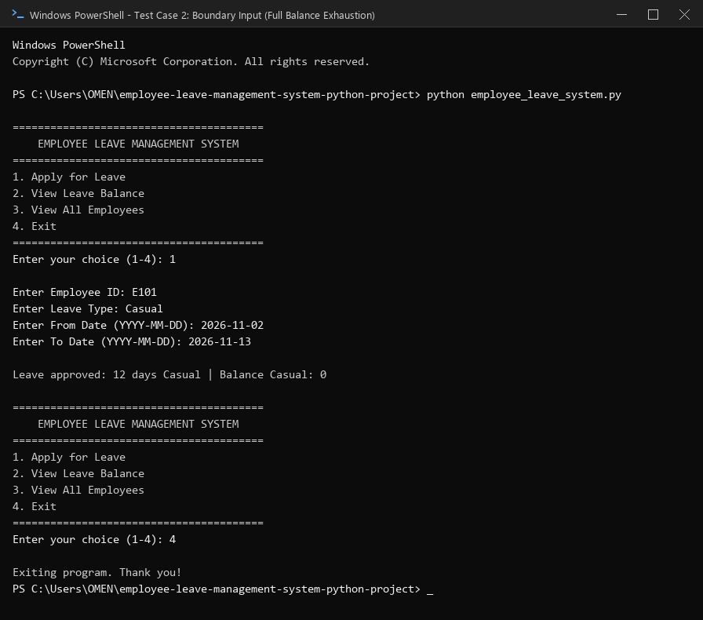
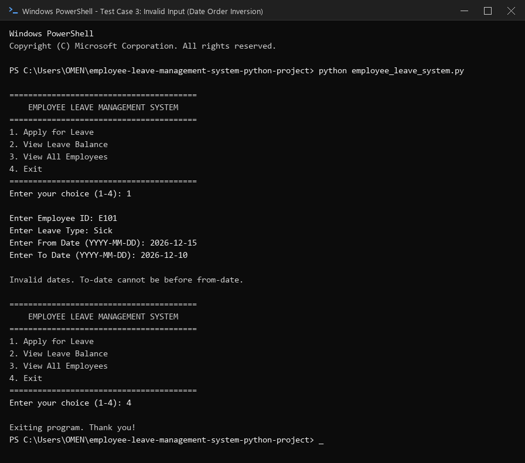
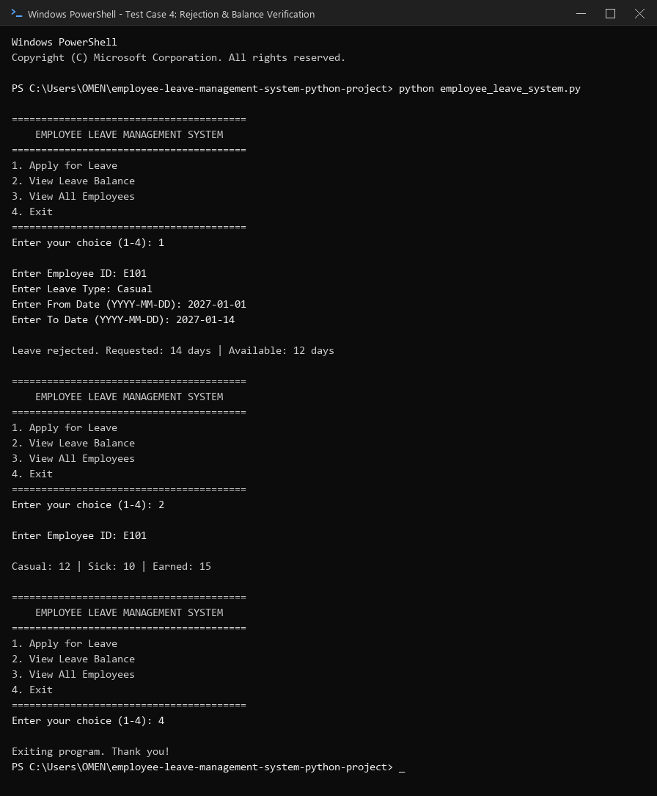

# Employee Leave Management System (PS No. 72)

[](https://www.python.org/)
[](#-how-to-run-the-program)
[](LICENSE)

> **Rungta International Skills University**  
> **School of Computer Science and Engineering**  
> *Bachelor of Technology - Computer Science and Engineering (Section K)*  
> **Course:** Programming Fundamentals and Logic Building Using Python (`RU-100-01-0021`)

A standalone, console-based Python 3 employee leave management system engineered under **Problem Statement No. 72**. The application manages employee leave quotas, computes inclusive calendar absence durations via Python's `datetime` engine, enforces strict defensive validation barriers, mutates balances atomically upon affirmative approval, and provides persistent CSV audit logging.

---

## 📌 Problem Statement Details

- **PS No.:** 72
- **Project Title:** Employee Leave Management System
- **Description:** Develop a console application that manages employee leave. An employee applies for leave of a given type between two dates; the program calculates the number of days, checks the leave balance and approves or rejects the request.
- **Language:** Python 3
- **Concepts:** Dictionaries, Conditions, Functions, Dates, CSV Persistence
- **Official Specification Note:**
  Employee `E101` (`Amit`) has yearly balance: `Casual 12`, `Sick 10`, `Earned 15` days. Dates are entered as `YYYY-MM-DD` and days are counted inclusive of both dates. Leave is approved only if the balance is enough.

---

## 🚀 Bare Minimum Requirements Compliance

| # | Bare Minimum Requirement | Implementation Detail | Status |
|---|--------------------------|-----------------------|:------:|
| **1** | Write the solution in Python 3 (one `.py` file) and run it from the console | Standalone single-file solution in [`employee_leave_system.py`](employee_leave_system.py) with zero external pip dependencies | **PASS** |
| **2** | Store employees and their leave balances in a nested dictionary | Implemented via `DEFAULT_EMPLOYEES` nested dictionary schema: `{ID: {name, dept, balances: {Casual, Sick, Earned}}}` | **PASS** |
| **3** | Use the `datetime` module to parse dates and calculate leave days | Parsed via `datetime.strptime(..., "%Y-%m-%d")` with inclusive calendar algebra `(to - from).days + 1` | **PASS** |
| **4** | Validate employee ID, leave type, date format and date order; approve or reject using conditions | Handled in `validate_employee_id()`, `validate_leave_type()`, `parse_and_validate_dates()`, and `check_leave_balance()` | **PASS** |
| **5** | Reduce balance on approval and provide view-balance option using functions | `apply_leave()` decrements balance only upon approval; `view_balance()` formats exact balance string | **PASS** |

---

## 📁 Project Structure

```text
Employee Leave Management System/
│
├── employee_leave_system.py          # Standalone single-file solution (Requirements 1-5)
├── main.py                           # CLI entry point and argument dispatcher
├── test_leave_system.py              # Automated unittest regression suite (9 unit tests)
├── employees.csv                     # Primary benchmark dataset (E101, E102, E103)
├── leave_records.csv                 # Transaction audit trail (Application ledger)
├── test_case_empty.csv               # Empty dataset verifying fallback to in-memory defaults
├── test_case2_boundary.csv           # Single-record boundary dataset
├── test_case3_edge_cases.csv         # Edge cases (zero balances, exhausted leave)
├── test_case4_dirty.csv              # Unsanitized whitespace, mixed-case headers
├── summary.md                        # Academic summary report & Viva examination guide
├── test_case_1_terminal.png          # Terminal screenshot for Test Case 1
├── test_case_2_terminal.png          # Terminal screenshot for Test Case 2
├── test_case_3_terminal.png          # Terminal screenshot for Test Case 3
├── test_case_4_terminal.png          # Terminal screenshot for Test Case 4
├── terminal_all_testcases.png        # Full sequential terminal execution capture
├── generate_terminal_screenshots.py  # Laptop terminal capture generator
├── requirements.txt                  # Python runtime specifications
├── .gitignore                        # Git ignore file
└── README.md                         # Technical system documentation
```

---

## 📊 Benchmark Dataset (`employees.csv`)

```csv
EmployeeID,Name,Department,Casual,Sick,Earned
E101,Amit,Software Engineering,12,10,15
E102,Priya Sharma,Quality Assurance,10,8,12
E103,Rahul Verma,Product Management,12,10,20
```

---

## 🧪 Test Cases & Terminal Executions

### Test Case 1: Normal Input (Leave Approved)
- **Menu Choice:** `1` (Apply for Leave)
- **Employee ID:** `E101`
- **Leave Type:** `Casual`
- **From Date:** `2026-12-10`
- **To Date:** `2026-12-12`
- **Expected Console Output:**
```text
Leave approved: 3 days Casual | Balance Casual: 9
```



---

### Test Case 2: Boundary / Minimum Input (Full Balance Exhaustion)
- **Menu Choice:** `1` (Apply for Leave)
- **Employee ID:** `E101`
- **Leave Type:** `Casual`
- **From Date:** `2026-11-02`
- **To Date:** `2026-11-13` (12 days = full balance)
- **Expected Console Output:**
```text
Leave approved: 12 days Casual | Balance Casual: 0
```



---

### Test Case 3: Invalid Input (Date Order Inversion)
- **Menu Choice:** `1` (Apply for Leave)
- **Employee ID:** `E101`
- **Leave Type:** `Sick`
- **From Date:** `2026-12-15`
- **To Date:** `2026-12-10`
- **Expected Console Output:**
```text
Invalid dates. To-date cannot be before from-date.
```



---

### Test Case 4: Different Valid Scenario (Over-Allocation Rejection & Balance Lookup)
- **(a) Apply for Over-Allocation:**
  - **Menu Choice:** `1`
  - **Employee ID:** `E101`
  - **Leave Type:** `Casual`
  - **From Date:** `2027-01-01`
  - **To Date:** `2027-01-14` (14 days requested > 12 days available)
  - **Expected Console Output:**
  ```text
  Leave rejected. Requested: 14 days | Available: 12 days
  ```
- **(b) View Balance Verification:**
  - **Menu Choice:** `2` (View Leave Balance)
  - **Employee ID:** `E101`
  - **Expected Console Output:**
  ```text
  Casual: 12 | Sick: 10 | Earned: 15
  ```



---

## 📁 Multi-Scenario CSV Datasets Matrix

Beyond the primary benchmark dataset, the project includes dedicated test CSV files to evaluate edge-case fault tolerance:

| Dataset File | Target Test Scenario | Record Count | Verification Scope | Status |
|---|---|:---:|---|:---:|
| `employees.csv` | Official Benchmark Dataset | 3 | Official Test Cases 1, 2, 3, and 4 | **PASS** |
| `leave_records.csv` | Transaction Audit Ledger | Variable | Append-only persistence of approved and rejected requests | **PASS** |
| `test_case_empty.csv` | Empty File Guardrail | 0 | Verifies graceful fallback to default database without crashing | **PASS** |
| `test_case2_boundary.csv` | Single-Record Boundary | 1 | Verifies single employee isolation | **PASS** |
| `test_case3_edge_cases.csv` | Zero Balances & Outliers | 2 | Verifies immediate rejection when available balance is 0 | **PASS** |
| `test_case4_dirty.csv` | Defensive Whitespace Scrubbing | 2 | Strips trailing whitespace and normalizes case | **PASS** |

---

## 💻 How to Run the Program

Open Windows PowerShell or any terminal and navigate to the project directory:

```powershell
cd " E:\Employee Leave Management System\

# 1. Run the interactive console application
python employee_leave_system.py

# Or launch via main entrypoint
python main.py

# 2. Run built-in specification verifier
python employee_leave_system.py --test

# 3. Run automated unittest regression suite (9 unit tests)
python test_leave_system.py -v
```
