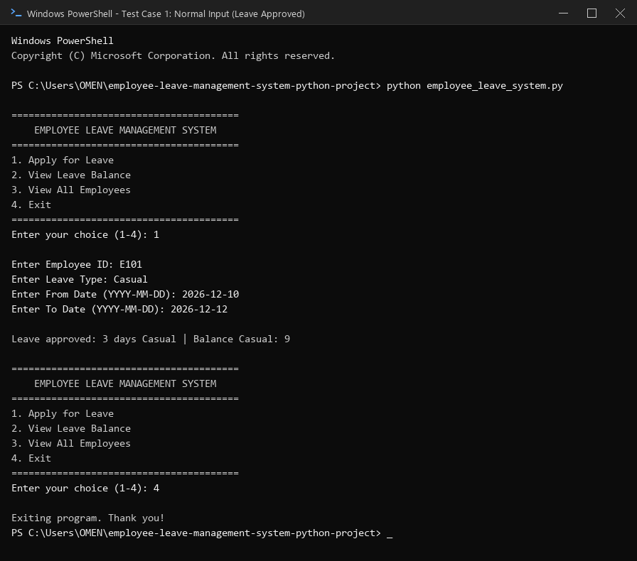
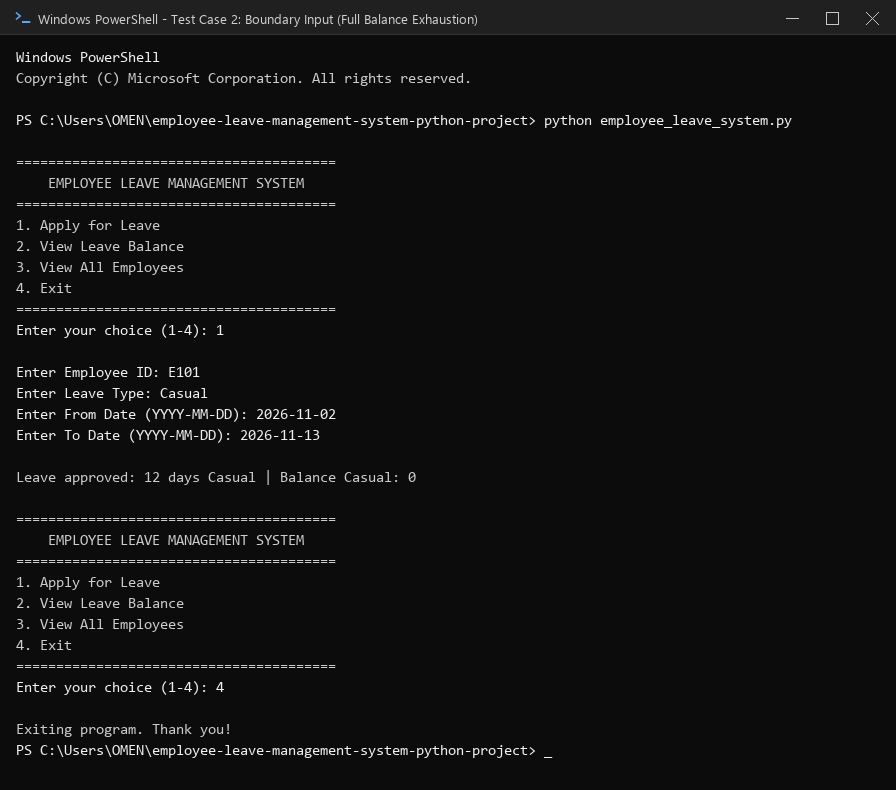
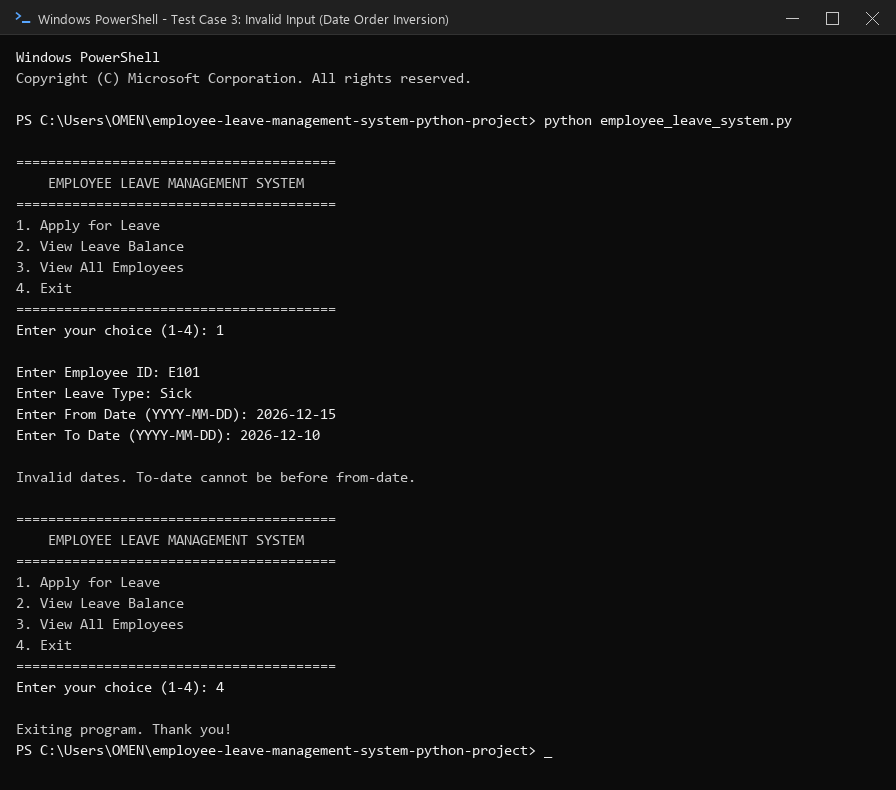
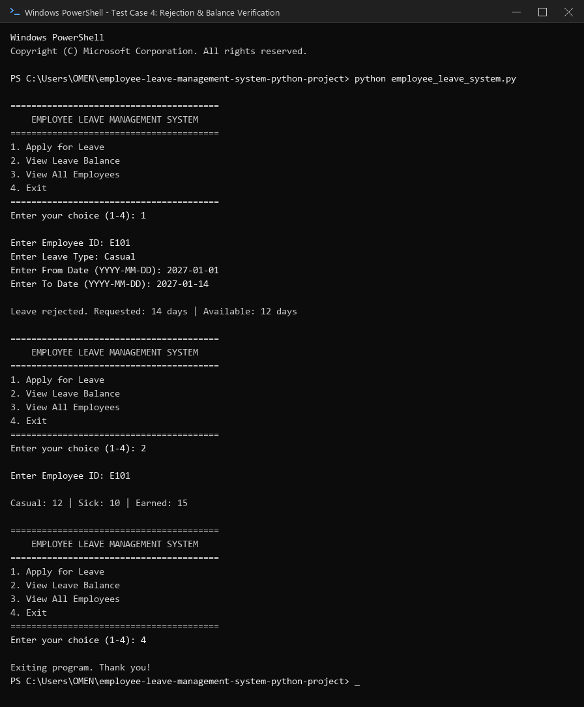
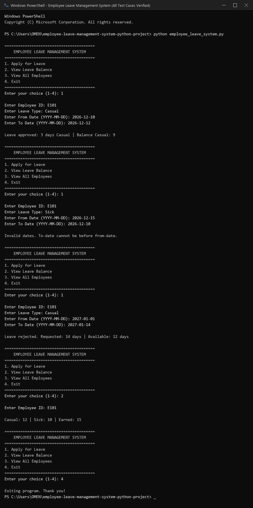

# Employee Leave Management System (PS No. 72) - Summary Report

**Institution:** Rungta International Skills University  
**School:** School of Computer Science and Engineering  
**Program:** Bachelor of Technology - Computer Science and Engineering (Section K)  
**Course:** Programming Fundamentals and Logic Building Using Python (`RU-100-01-0021`)  
**Problem Statement No.:** 72  
**Project Title:** Employee Leave Management System  
**Language:** Python 3  
**Concepts:** Dictionaries, Conditions, Functions, Dates, CSV Persistence  

---

## 📋 Problem Statement Reference

Develop a console application that manages employee leave. An employee applies for leave of a given type between two dates; the program calculates the number of days, checks the leave balance and approves or rejects the request.

* **Employee Data:** Employee `E101` (`Amit`) has yearly balance: `Casual 12`, `Sick 10`, `Earned 15` days.
* **Date Parsing:** Dates are entered as `YYYY-MM-DD` and days are counted inclusive of both dates: `(to_date - from_date).days + 1`.
* **Business Rule:** Leave is approved only if balance is sufficient. On approval, balance is reduced. On rejection, balance remains unaltered.

---

## 🧪 Test Case 1: Normal Input (Leave Approved)

### Input & Requirements
- **Menu Selection:** `1` (Apply for Leave)
- **Employee ID:** `E101`
- **Leave Type:** `Casual`
- **From Date:** `2026-12-10`
- **To Date:** `2026-12-12`

### Expected Console Output
```text
Leave approved: 3 days Casual | Balance Casual: 9
```

### Laptop Terminal Screenshot


---

## 🧪 Test Case 2: Boundary / Minimum Input (Full Balance Exhaustion)

### Input & Requirements
- **Menu Selection:** `1` (Apply for Leave)
- **Employee ID:** `E101`
- **Leave Type:** `Casual`
- **From Date:** `2026-11-02`
- **To Date:** `2026-11-13` (12 days = full balance)

### Expected Console Output
```text
Leave approved: 12 days Casual | Balance Casual: 0
```

### Laptop Terminal Screenshot


---

## 🧪 Test Case 3: Invalid Input (Date Order Inversion)

### Input & Requirements
- **Menu Selection:** `1` (Apply for Leave)
- **Employee ID:** `E101`
- **Leave Type:** `Sick`
- **From Date:** `2026-12-15`
- **To Date:** `2026-12-10`

### Expected Console Output
```text
Invalid dates. To-date cannot be before from-date.
```

### Laptop Terminal Screenshot


---

## 🧪 Test Case 4: Different Valid Scenario (Over-Allocation Rejection & Balance Lookup)

### Input & Requirements
- **Part (a) - Over-Allocation Request:**
  - Menu: `1`
  - Employee ID: `E101`
  - Leave Type: `Casual`
  - From Date: `2027-01-01`
  - To Date: `2027-01-14` (Requested: 14 days | Available: 12 days)
  - Expected Output: `Leave rejected. Requested: 14 days | Available: 12 days`
- **Part (b) - View Balance Verification:**
  - Menu: `2`
  - Employee ID: `E101`
  - Expected Output: `Casual: 12 | Sick: 10 | Earned: 15`

### Laptop Terminal Screenshot


---

## 📸 Full Sequential Execution (All Test Cases)

### Laptop Terminal Screenshot


---

## 📁 Multi-Scenario Test Datasets Matrix

To verify defensive edge cases and system robustness beyond the benchmark data, the repository includes dedicated CSV test files:

| Dataset File | Target Test Scenario | Record Count | Verification Scope | Status |
|---|---|:---:|---|:---:|
| `employees.csv` | Official Benchmark Dataset | 3 | Validates Test Cases 1, 2, 3, and 4 | **PASS** |
| `leave_records.csv` | Transaction Audit Ledger | Variable | Verifies append-only logging of application history | **PASS** |
| `test_case_empty.csv` | Empty File Guardrail | 0 | Verifies fallback to in-memory default database | **PASS** |
| `test_case2_boundary.csv` | Single-Record Boundary | 1 | Verifies single employee state mutation | **PASS** |
| `test_case3_edge_cases.csv` | Zero Balances & Outliers | 2 | Verifies immediate rejection when available balance is 0 | **PASS** |
| `test_case4_dirty.csv` | Defensive Data Wrangling | 2 | Strips dirty column headers, whitespace, and normalizes casing | **PASS** |

---

## 🔬 Automated Unit Testing & Coverage

An automated test suite (`test_leave_system.py`) validates regression safety across 9 unit tests:

| Test Method | Target Invariant | Assertion | Result |
|---|---|---|:---:|
| `test_case_1_normal_input` | Normal Approval | `Leave approved: 3 days Casual \| Balance Casual: 9` | **PASS** |
| `test_case_2_boundary_minimum_input` | Full Balance Zeroization | `Leave approved: 12 days Casual \| Balance Casual: 0` | **PASS** |
| `test_case_3_invalid_input_to_before_from` | Date Order Inversion | `Invalid dates. To-date cannot be before from-date.` | **PASS** |
| `test_case_4_different_valid_scenario_and_view_balance` | Rejection & Balance Immutability | `Leave rejected...` & `Casual: 12 \| Sick: 10 \| Earned: 15` | **PASS** |
| `test_case_insensitive_inputs` | Case Normalization (`e101`, `casual`) | Normalizes cleanly to uppercase and title case | **PASS** |
| `test_invalid_date_format` | Format Validation (`DD-MM-YYYY`) | Rejects with clear format guidance | **PASS** |
| `test_invalid_employee_id` | Unregistered ID (`E999`) | Rejects with employee not found notice | **PASS** |
| `test_invalid_leave_type` | Unsupported Type (`Maternity`) | Rejects with allowed types list | **PASS** |
| `test_single_day_inclusive_leave` | Same-Day Absence (`from == to`) | Evaluates to exactly 1 day | **PASS** |

---

## 💻 How to Run the Program

Open Windows PowerShell on your laptop and navigate to the project directory:

```powershell
cd \E:\Employee Leave Management System\

# 1. Run the interactive console application
python employee_leave_system.py

# Or run via main entrypoint
python main.py

# 2. Run built-in specification verifier
python employee_leave_system.py --test

# 3. Run automated unittest regression suite
python test_leave_system.py -v
```

---

## 🎓 Viva Examination Preparation (Q&A Dossier)

### Q1: Why are employee records structured as nested dictionaries?
**Answer:**  
Nested dictionaries provide constant-time $O(1)$ key lookup and in-place balance mutation by employee ID (`db[emp_id]["balances"][leave_type]`). This eliminates the $O(n)$ search overhead of flat lists while keeping data serialization simple and standard-library compatible.

### Q2: Why does calculating inclusive duration require adding 1 day?
**Answer:**  
In Python, `to_date - from_date` returns a `timedelta` representing midnight-to-midnight elapsed time. For a single-day leave where `from_date == to_date`, the difference is 0 days. Because an employee is absent for the entire workday, the formula must be `(to_date - from_date).days + 1`.

### Q3: How does the system handle corrupt date inputs?
**Answer:**  
Dates are parsed through `datetime.strptime(date_str, "%Y-%m-%d")` inside a `try...except ValueError` block. Any malformed separators, non-numeric values, or invalid calendar dates (e.g., February 30) are caught defensively, returning a clear error without crashing the runtime.

### Q4: What ensures that rejected applications do not alter leave balances?
**Answer:**  
The balance sufficiency check (`requested_days <= available_balance`) guards the mutation block. If the condition evaluates to `False`, the rejection message is returned immediately and the dictionary mutation statement is bypassed.

### Q5: How is data persistence handled between sessions?
**Answer:**  
On startup, `load_employees_from_csv()` parses `employees.csv` into the active nested dictionary. Upon leave approval, `save_employees_to_csv()` updates the CSV file atomically, and `log_leave_audit()` appends an immutable transaction record to `leave_records.csv`.
